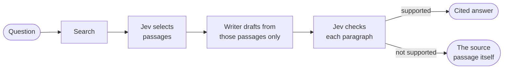

<p align="center">
  <picture>
    <source media="(prefers-color-scheme: dark)" srcset="https://raw.githubusercontent.com/zearchcomputer/zearch/main/zearch-logo.svg">
    
  </picture>
</p>

<h3 align="center">Answers you can check, inside any MCP client.</h3>

`@zearchcomputer/mcp` connects Claude, Cursor, VS Code and other [Model Context Protocol](https://modelcontextprotocol.io) clients to [Zearch](https://zearch.computer). Ask a question and you get an answer whose every paragraph was checked against the source it cites, with the exact passage Zearch read. Or check text your own model wrote against sources you already have.

> **Status:** early. The Zearch API is not open to everyone yet.

[](https://www.npmjs.com/package/@zearchcomputer/mcp)

## How an answer is made



Jev is TypeSafe AI's evidence model. When a paragraph can't be supported it is cut, and when nothing survives you get the best source passage instead of a guess (`answer_type: "excerpt"`).

## Tools

| Tool | What it does | Credits |
|---|---|---|
| `research` | Checked answer with numbered sources and the passages Jev read. Modes: `standard`, `deep` (a report from up to 8 sources), `compare`, `scrape` (one page), `crawl` (up to five pages of a site), `reverse` (how an app, repo or site works, from static analysis). Follow-ups with `parent_id`. | 1 · 5 · 2 · 1 · 3 · 10; follow-up 0.3 |
| `verify` | Checks your text against your sources, paragraph by paragraph: pass/fail, support and attribution scores. Cite sources as `[1]`, `[2]`… | 1 |
| `get_run` | Reopens a run, or checks on a queued `reverse` run. | free |
| `list_runs` | Your recent runs (shared with the Zearch app). | free |
| `get_wallet` | Credit balance, lots and expiry, recent ledger entries. | free |
| `get_pricing` | Public price list. No key needed. | free |

Errors are never charged. A run that can only return a source passage costs half.

**Progress.** `research` streams its stages (*Searching the web → Choosing the most relevant evidence → Checking each claim against its source*) as MCP progress notifications, so clients that show progress show what Zearch is doing.

**Answer view.** In clients that support [MCP Apps](https://modelcontextprotocol.io/extensions/apps), `research`, `get_run` and `verify` render an inline card: the answer with citation chips, source cards with the excerpt Jev read, an *Open* button for each source, and follow-up suggestions. It follows the client's light or dark theme. Other clients get the same content as text. Set `ZEARCH_UI=0` to turn it off.

**Resources.** `zearch://runs/{id}` (a run as Markdown; your recent runs are listed), `zearch://pricing`.

**Prompts.** `research_brief` (a cited brief from deep research), `fact_check` (find sources for a draft, then verify it), `compare` (a table with a citation in every cell).

## Install

You need a Zearch API key (`zk_live_…`). Create one in the Zearch app under **Account → API keys**.

### Claude Code

```sh
claude mcp add zearch --env ZEARCH_API_KEY=zk_live_your_key -- npx -y @zearchcomputer/mcp
```

### Claude Desktop

In *Settings → Developer → Edit config*, add:

```json
{
  "mcpServers": {
    "zearch": {
      "command": "npx",
      "args": ["-y", "@zearchcomputer/mcp"],
      "env": { "ZEARCH_API_KEY": "zk_live_your_key" }
    }
  }
}
```

### Cursor

`.cursor/mcp.json` (project) or `~/.cursor/mcp.json` (global): the same `mcpServers` block as Claude Desktop.

### VS Code

`.vscode/mcp.json`, which prompts for the key instead of storing it:

```json
{
  "inputs": [{ "type": "promptString", "id": "zearch-key", "description": "Zearch API key", "password": true }],
  "servers": {
    "zearch": {
      "type": "stdio",
      "command": "npx",
      "args": ["-y", "@zearchcomputer/mcp"],
      "env": { "ZEARCH_API_KEY": "${input:zearch-key}" }
    }
  }
}
```

### Run from source

```sh
git clone https://github.com/zearchcomputer/zearch-mcp
cd zearch-mcp
npm ci && npm run build
```

Then use `node /absolute/path/to/zearch-mcp/dist/index.js` as the command in any config above, instead of `npx -y @zearchcomputer/mcp`.

## Remote (HTTP) mode

```sh
npx -y @zearchcomputer/mcp --http --port 8787            # http://127.0.0.1:8787/mcp
```

Every request uses the caller's own key, sent as `Authorization: Bearer zk_live_…`; the server stores no keys. `ZEARCH_API_KEY` is used as a fallback only when the server listens on loopback, so a public deployment can't spend the operator's credits for someone else. `GET /healthz` reports liveness.

To serve on a public interface, bind it and list the hostnames you serve, so requests with other `Host` headers are refused:

```sh
npx -y @zearchcomputer/mcp --http --host 0.0.0.0 --port 8080 --allowed-hosts mcp.zearch.computer
```

A `Dockerfile` is included for this.

## Configuration

| Variable | Default | Purpose |
|---|---|---|
| `ZEARCH_API_KEY` | | Your API key. In HTTP mode, callers send their own. |
| `ZEARCH_API_URL` | `https://zearch.computer/v1` | API base URL. `http://` is accepted only for localhost. |
| `ZEARCH_TIMEOUT_MS` | `120000` | Per-request timeout. Research streams get at least 180 s. |
| `ZEARCH_REVERSE_WAIT_MS` | `300000` | How long `research` waits for a `reverse` run before returning its id for `get_run`. |
| `ZEARCH_UI` | on | `0` turns off the inline answer view. |
| `ZEARCH_MCP_ALLOWED_HOSTS` | | Same as `--allowed-hosts`. |
| `PORT` | `8787` | HTTP port when `--port` isn't given. |

## Reliability

- Each `research` call carries an idempotency key, reused across retries, so a retried request never runs or charges twice.
- Network failures, 5xx responses and per-minute rate limits are retried with backoff that honours `Retry-After`. Out-of-credit, auth and validation errors are not retried; they come back as a tool error that says what to do next.
- If a research stream drops, the server reads the finished run instead of failing.
- Cancelling a tool call in the client cancels the request to Zearch.
- Logs go to stderr. Keys are never logged.

## Development

```sh
npm ci
npm test        # builds, then runs the tests against a local mock of the Zearch API
```

Tests make no network calls beyond localhost and spend no credits. The view is a single dependency-free HTML file in `src/ui/answer.html`.

The server is built on the [MCP TypeScript SDK v2](https://ts.sdk.modelcontextprotocol.io/v2/) (protocol revision 2026-07-28, with 2025-era clients still served) and talks to the [Zearch API](https://github.com/zearchcomputer/zearch/blob/main/docs/API.md).

## Security

Report vulnerabilities privately through [GitHub security advisories](https://github.com/zearchcomputer/zearch-mcp/security/advisories/new). See the [security policy](https://github.com/zearchcomputer/.github/blob/main/SECURITY.md).

## License

[MIT](LICENSE)
